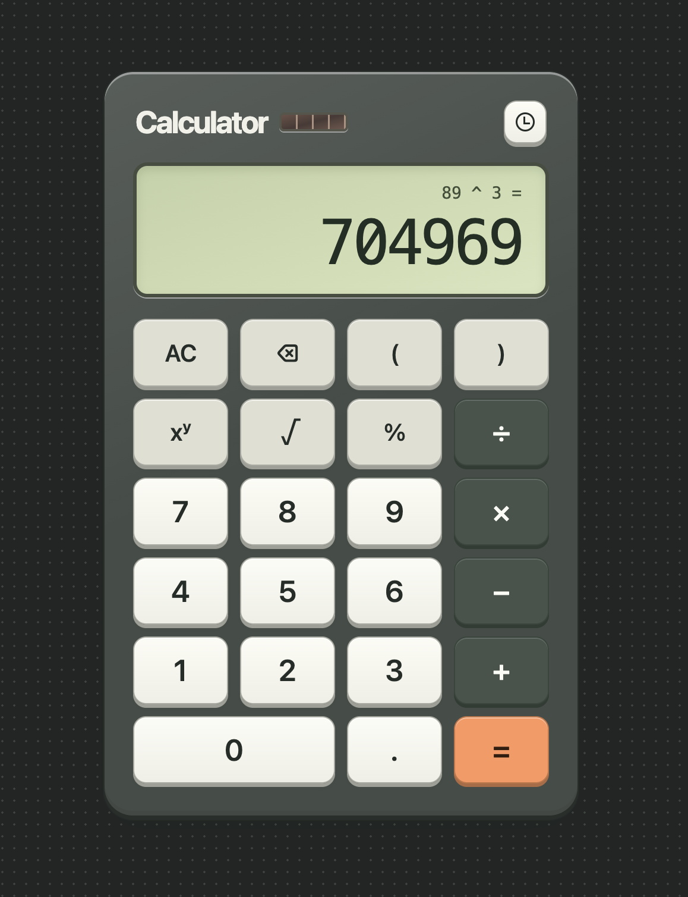

# Calculator
A responsive calculator web app built with React and TypeScript for frontend and Go for server side evaluation.



This calculator supports basic arithmetic, powers, square roots, percentages and nested parentheses.

## Project Structure

```text
├── backend/
│   ├── api/             # HTTP presentation layer(routing, payload validation, status codes)
│   ├── calculator/      # core arithmetic engine(parser, big.Rat math, precision rounding)
│   ├── go.mod           # zero external dependencies(Go 1.22+ standard library only)
│   └── main.go          # server entrypoint with timeouts
├── frontend/
│   ├── src/
│   │   ├── components/  # modular React UI(Calculator, Display, Keypad, HistoryMenu)
│   │   ├── constants/   # keypad layout, labels and keyboard shortcut mappings
│   │   ├── hooks/       # useCalculator state and lifecycle management
│   │   ├── services/    # isolated API client for /api/calculate
│   │   └── types/       # shared TypeScript interfaces
│   ├── test/            # client unit and integration tests(built in Node test runner)
│   └── nginx.conf       # production reverse proxy config
├── Dockerfile           # minimal multi stage container build
├── compose.yaml         # compose configuration exposing port 3000
├── prompt.md            # documented AI prompts used during development
└── shot.png             # application UI screenshot
```

## Run Locally

This app requires Go 1.22+ and Node.js 20 OR 22 with npm.

To run the calculator, open two separate terminals from project root to start each service.

### Terminal 1 - Backend (Go)
```sh
cd backend && go run .
```
Go server listens on `127.0.0.1:8080`(requires zero external dependency downloads).

### Terminal 2 - Frontend (React + Vite)
```sh
cd frontend && npm ci && npm run dev
```

Open URL from Vite logs, usually `http://localhost:5173`

## Run with Docker

Start Docker Desktop, then run from the project root:

```sh
# validate compose configuration
docker compose config

# build and start both services
docker compose up --build
```

Open `http://localhost:3000` to access the application.

Both containers share a network namespace, allowing Nginx to forward `/api/` requests internally to Go at `127.0.0.1:8080`. Only the frontend publishes a host port (`3000`).

To stop and remove containers, run:
```sh
docker compose down
```

## Controls & Keyboard Shortcuts

| Keyboard | Action |
| --- | --- |
| `0`-`9`, `.`, `+`, `-`, `*`, `/`, `^`, `%`, `(`, `)` | Enter an expression |
| `r` | Open a square root with `√(` |
| Enter OR `=` | Calculate OR repeat last operation |
| Backspace | Delete last input |
| Escape | Close history drawer if open, otherwise clear the calculation |

- Use `×` explicitly before a group, e.g., `2 × (3 + 4)`.
- History icon shows last three successful calculations.

## Design Decisions & Assumptions

### 1. Single Expression Endpoint(`POST /api/calculate`) vs Granular Endpoints
- **Decision**: create a single REST endpoint accepting an expression string rather than individual endpoints for each operator(`/add`, `/subtract`, `/multiply`, `/divide`).
- **Rationale**: real world calculator interactions frequently involve compound expressions with mixed operators(e.g., `2 + 3 × 4`), nested parentheses and contextual percentages. 
A single expression endpoint evaluates entire mathematical operation with accurate operator precedence in one round trip, avoiding multiple sequential network requests and keeping server completely stateless.

### 2. Exact Rational Arithmetic(`big.Rat`) vs IEEE 754 Floating Point
- **Decision**: perform arithmetic using arbitrary precision rational fractions(`math/big.Rat`), rounding only final result to 15 significant decimal digits(round half to even).
- **Rationale**: standard 64 bit binary floating point(`float64`) introduces well known binary representation inaccuracies(such as `0.1 + 0.2 = 0.30000000000000004` OR `(1/3) * 3 ≠ 1`). 
Using exact fractions ensures financial grade correctness throughout intermediate evaluation steps.

### 3. Contextual Percentage
- **Assumption**: percentage calculation adheres to standard physical and mobile calculator behavior:
  - `200 + 10%` evaluates to `220`(adds 10% of 200)
  - `200 − 10%` evaluates to `180`.
  - `200 × 10%` evaluates to `20`
  - `200 ÷ 10%  evaluates to `2000`
  - `10% evaluates to 0.1`

### 4. Repeat Equals Behavior
- **Assumption**: 
  - Repeatedly pressing `=` replicates last entered operation and right operand
(e.g., `8 + 3 = 11`, `=` -> `14`, `=` -> `17`). 
  - Entering a new number followed by `=` applies same operation to new value (`20 =` -> `23`), mirroring standard handheld calculator mechanics

### 5. Zero Third Party Backend Dependencies
- **Decision**: Go backend uses exclusively standard library packages(`net/http`, `math/big`, `encoding/json`, `mime`).
- **Rationale**: 
  - Standard library Go is fast, idiomatic and secure
  - It eliminates third party supply chain risks
  - Ensures instant compilation without `go get` dependency downloads
  - Yields a minimal Docker container footprint(~10 MB scratch binary)

### 6. Dual Layer Validation & Strict Guardrails
- **Decision**: Enforce validation on both client and server:
  - **Client**: Prevents invalid key sequences(e.g., multiple decimal points, unmatched closing parentheses, excessive digit length).
  - **Server**: Enforces a 16 KiB request body ceiling via `http.MaxBytesReader`, rejects unknown JSON fields (`DisallowUnknownFields`), blocks trailing JSON tokens and handles edge cases(division by zero, domain errors and magnitude overflow/underflow) with distinct HTTP status codes(400, 404, 405, 413, 415, 422).

### 7. Native Built in Test Runners
- **Decision**: Utilize Go's built in `testing` framework (with `-race` and fuzzing) and Node.js native `node:test` runner
- **Rationale**: Eliminates external test frameworks(such as Jest or Vitest), reducing dependency maintenance overhead while enabling fast, native execution directly via `npm test` and `go test`

## API Specification

### Endpoint
`POST /api/calculate`
- **Headers**: `Content-Type: application/json`
- **Body Limit**: 16 KB (`http.MaxBytesReader`)
- **Validation**: Unknown JSON fields and trailing JSON tokens are strictly rejected.

### Example Request(curl)
```sh
curl http://127.0.0.1:8080/api/calculate \
  -H 'Content-Type: application/json' \
  -d '{"expression":"(200 + 10%) / 2"}'
```

### Success Response (`200 OK`)
```json
{"result":110}
```

### Error Responses

#### `400 Bad Request` (Invalid syntax or JSON)
```json
{"error":{"code":"invalid_json","message":"Send one JSON object with an expression string."}}
```
```json
{"error":{"code":"invalid_expression","message":"Expected a closing parenthesis."}}
```

#### `405 Method Not Allowed`
```json
{"error":{"code":"method_not_allowed","message":"Use POST for calculations."}}
```

#### `413 Payload Too Large`
```json
{"error":{"code":"body_too_large","message":"Request exceeds 16 KiB."}}
```

#### `415 Unsupported Media Type`
```json
{"error":{"code":"unsupported_media_type","message":"Send application/json."}}
```

#### `422 Unprocessable Entity` (Arithmetic, domain, or range errors)
```json
{"error":{"code":"division_by_zero","message":"Cannot divide by zero."}}
```
```json
{"error":{"code":"domain_error","message":"Square root requires a nonnegative value."}}
```
```json
{"error":{"code":"out_of_range","message":"Number exceeds the supported range."}}
```

## Test and Build

Run these commands from corresponding folder. Install frontend dependencies with `npm ci` first.

| Folder | Tests | Production Build |
| --- | --- | --- |
| `backend/` | `go test -race ./...` & `go vet ./...` | `go build -trimpath -o calculator-api .` |
| `frontend/` | `npm test` | `npm run build` |

For production, serve `frontend/dist/` over HTTPS and reverse proxy `/api/calculate` to Go service at `127.0.0.1:8080`.

## Test Coverage Report

| Code Measured | Metric | Coverage |
| --- | --- | ---: |
| Go API Presentation (`calculator/api`) | Statements | **97.1%** |
| Go Arithmetic Engine (`calculator/calculator`) | Statements | **97.4%** |
| Combined Go Backend | Statements | **97.3%** |
| Calculator State (`calculator.ts`) | Lines | 95.71% |
| Keypad Editor (`editor.ts`) | Lines | 100% |
| API Client (`services/api.ts`) | Lines | 100% |

- **Backend**: Run `go test -cover ./...` from `backend/` to regenerate Go coverage.
- **Frontend**: Run `node --experimental-test-coverage --test test/*.test.mjs` from `frontend/` after `npm test` to regenerate the frontend coverage report.

## AI Tooling & Prompts
- prompts used throughout iterative development of this application are documented and shared in [`prompt.md`](./prompt.md).
